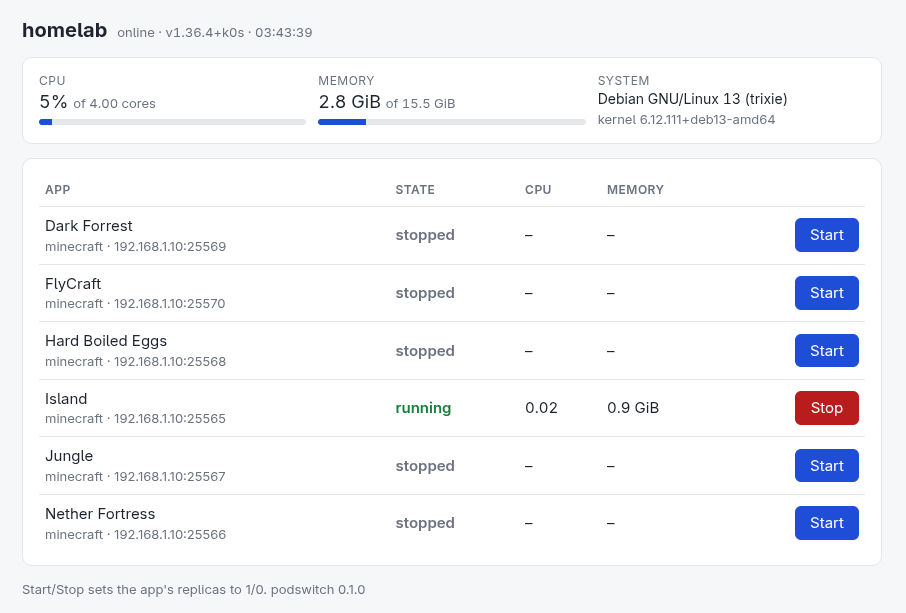

<p align="center">
  
</p>

<h1 align="center">podswitch</h1>

<p align="center">
  <a href="https://github.com/xuedi/podswitch/actions/workflows/ci.yml"></a>
  <a href="https://github.com/xuedi/podswitch/releases"></a>
  <a href="LICENSE"></a>
  <a href="https://go.dev"></a>
  
  
</p>

<p align="center"><b>On/off switches for the apps in your Kubernetes cluster.</b><br>
A small web page that lists your apps with a Start and a Stop button<br>
and shows "offline" when the cluster is switched off.</p>

---

I have a home server with Kubernetes that is only switched on when I need it, and a few apps on it
that I start by hand, mostly game servers. I did not want to open a full admin UI or type
`kubectl scale` every time, so podswitch is one page with the apps, their state and usage, and a
button for each.

<p align="center"></p>

## Why podswitch

- **Small.** One static Go binary, standard library only. The container image is only the binary
  (`FROM scratch`), about 8 MB, and it uses around 15 MB of memory.
- **No load when nobody looks.** An open page polls every 500 ms. All open pages share one
  snapshot, and 15 s after the last page is closed podswitch stops calling the API.
- **Runs outside the cluster.** Put it on any small machine that is always on. When the cluster is
  off, the page shows that and picks it up again once it is back.
- **Least privilege.** It uses its own service-account token, which can read workloads, pods,
  nodes and metrics and change replica counts in the namespaces you allow. Nothing else: no
  create, delete, exec, logs or Secrets ([`deploy/rbac.yaml`](deploy/rbac.yaml)).
- **Nothing to install in the cluster.** No CRDs, no operator, no agent. Every Deployment and
  StatefulSet outside the system namespaces is listed, two optional annotations set a nicer name
  and an address.
- **The page updates in place.** It does not reload. The table is only redrawn when something
  changed, and it has a dark mode and works on a phone.

## How it works

Start and Stop set an app's replicas to **1** and **0** through the `scale` subresource, the same
as `kubectl scale`. So a stop works like with kubectl, including `preStop` hooks and graceful
shutdown. States come from the workload and its pods:

| State | Meaning |
|---|---|
| `running` | replicas wanted, and ready (add a readiness probe so this means "usable") |
| `starting` | replicas wanted, not ready yet |
| `stopping` | set to 0, pods still shutting down |
| `stopped` | set to 0, no pods left |

Cluster CPU and memory, and per-app usage, come from **metrics-server**. It measures about every
15 s, so those numbers move in steps; without metrics-server the page works and shows no usage.

## Install

**1. Give podswitch access.** Edit the `RoleBinding` at the end of [`deploy/rbac.yaml`](deploy/rbac.yaml)
to name your app namespace (one copy per namespace), apply it, and take out the token and the CA:

```bash
kubectl apply -f deploy/rbac.yaml
mkdir -p data
kubectl -n podswitch get secret podswitch-token -o jsonpath='{.data.token}'  | base64 -d > data/token
kubectl -n podswitch get secret podswitch-token -o jsonpath='{.data.ca\.crt}' | base64 -d > data/ca.crt
```

**2. Run it** on a machine that reaches the API server, with Docker or Podman:

```bash
docker run -d --name podswitch --restart unless-stopped -p 8080:8080 \
  -e PODSWITCH_API=https://192.168.1.10:6443 -v "$PWD/data:/data:ro" \
  --read-only --cap-drop ALL --security-opt no-new-privileges \
  ghcr.io/xuedi/podswitch:latest
```

or with [`deploy/docker-compose.yml`](deploy/docker-compose.yml), or as a plain binary
(`go install github.com/xuedi/podswitch@latest`, Go 1.24+). Images are built for amd64, arm64 and
armv7, so a Raspberry Pi or a 12 W ARM board is a fine home for it.

Open `http://<that machine>:8080/`.

## Configuration

Environment variables, all optional except the first:

| Variable | Default | |
|---|---|---|
| `PODSWITCH_API` | | The API server, e.g. `https://192.168.1.10:6443` |
| `PODSWITCH_TOKEN` | `/data/token` | Service-account token file |
| `PODSWITCH_CA` | `/data/ca.crt` | The cluster's CA certificate (PEM) |
| `PODSWITCH_LISTEN` | `:8080` | Listen address |
| `PODSWITCH_NAME` | first node's name | Shown in the header and the tab title |
| `PODSWITCH_HOST` | the API's host | Shown in front of an app's port |
| `PODSWITCH_HIDE_NAMESPACES` | `kube-system,kube-public,kube-node-lease,local-path-storage,podswitch` | Never listed, never switched |
| `TZ` | UTC | Time zone of the clock in the header |

Annotations on a Deployment or StatefulSet:

| Annotation | |
|---|---|
| `podswitch/title: "Island"` | Display name instead of the object's name |
| `podswitch/port: "25565"` | Shown as `<PODSWITCH_HOST>:25565`, where to reach the app |
| `podswitch/hide: "true"` | Not listed |

## Behind a reverse proxy, or inside armdash

All of podswitch's links are relative, so it works under any path prefix without configuration.
Bind it to loopback (`-p 127.0.0.1:8080:8080`) and let the proxy serve it.

I run it inside **[armdash](https://github.com/xuedi/armdash)**, my tiny home-server dashboard:
add a navbar link with the URL `http://127.0.0.1:8080` and the mode `proxy` on armdash's settings
page, and podswitch appears as one more tab next to your host's vitals and smart home, in a frame,
on HTTPS. Both are single static Go binaries and run fine on a small ARM board.

## Security

- **There is no login.** Anyone who can reach the page can switch apps on and off. Run it on a
  trusted LAN or behind a proxy that authenticates. What they cannot do is limited by the token:
  read and scale, only in the namespaces you bound.
- The switch endpoint refuses anything but replicas 0 or 1, other kinds than Deployments and
  StatefulSets, and hidden namespaces, before calling the API.
- The token and CA are files you mount read-only; nothing is written at runtime, so the container
  runs with a read-only root filesystem, as uid 65532, with all capabilities dropped.

## Development

```bash
just check                                   # gofmt, vet, tests
just run https://192.168.1.10:6443 data/token data/ca.crt
```

The tests run the whole read path, the switch endpoint and the offline case against a fake API
server; no cluster needed. The page is one HTML file with a small script, embedded in the binary.

## License

[EUPL v1.2](LICENSE)
